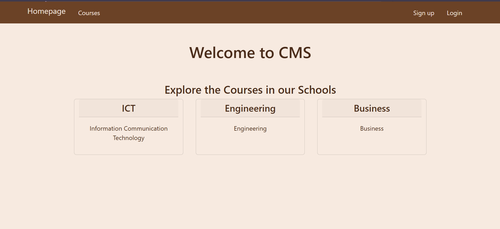
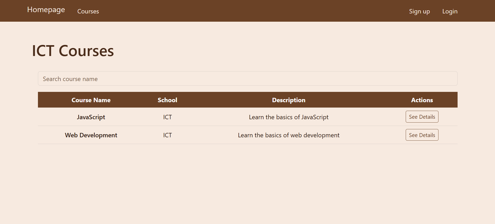
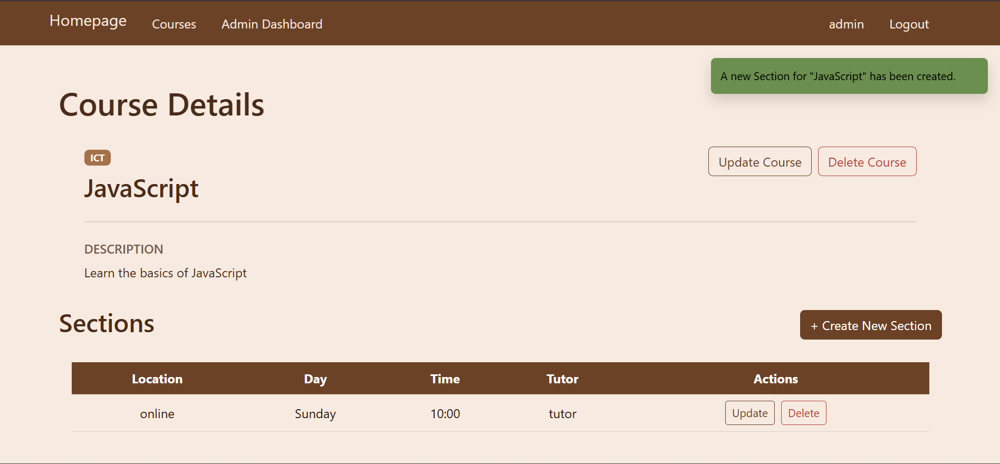
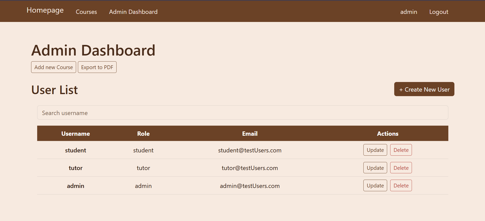
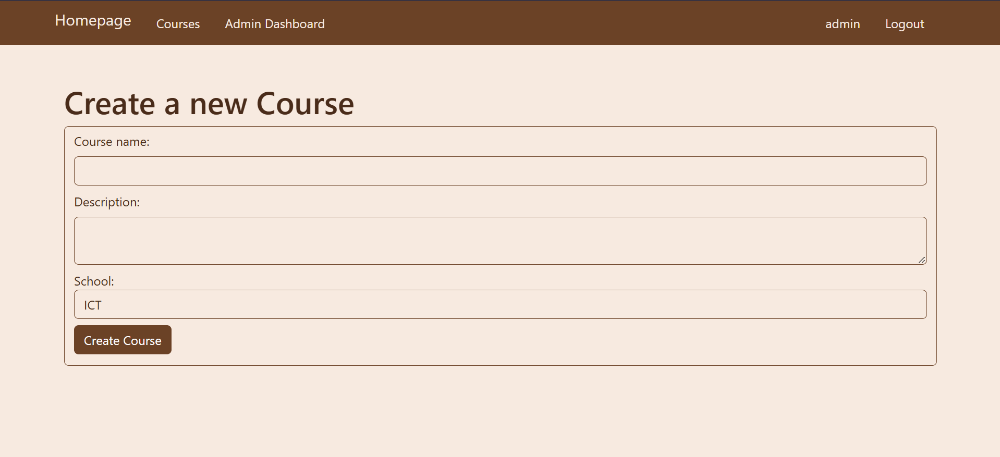
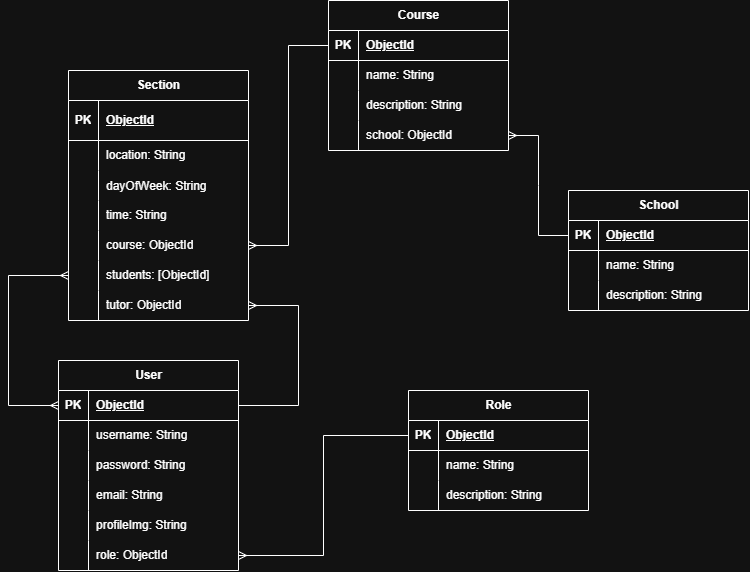

# Project Name
Course Management System

## Overview
This website is a Course / Section management system allowing admins to create, read, update, and delete courses and sections while allowing students to register for these courses.

## Screenshots







## Technologies Used
1. MEN Stack
2. Bootstrap

## Getting Started
1. Clone the repository 
```
git clone https://github.com/KhadijaAlsatrawi/Course-Management-System.git
```
2. cd into the folder
```
cd Course-Management-System
```
3. Install dependencies
```
npm i
```
4. Create .env file and add the following
```
MONGODB_URI = <Your Connection String to a MongoDB>
SESSION_SECRET= <Your Session Secret>
PORT=3000
```
5. Run the following for sample information
```
node seed.js
```
6. Run the website
```
nodemon server.js
```
7. Go to http://localhost:3000/ in your browser 

8. Sample users: 
```
| Username | password |
|----------|----------|
| admin    | a@test   |
| tutor    | t@test   |
| student  | s@test   |
```

## User Stories
1.	I as a user, want to sign in to the website.
2.	I as a user, want to change my password.
3.	I as a user, want to view all courses.
4.	I as a user, want to view all sections of a course.
5.	I as a student, want to register in a section.
6.	I as a student, want to see all the sections that I am in.
7.	I as a tutor, want to see the sections I teach.
8.	I as an admin, want to do CRUD on courses.
9.	I as an admin, want to do CRUD on sections.
10. I as an admin, want to do CRUD on users.


## Database Design


## Routes
| Method | Route                           | Page                       | Description                                           |
|--------|---------------------------------|----------------------------|-------------------------------------------------------|
| get    | /user/new                       | create-user.ejs            | Display the creation form                             |
| post   | /user/                          | -                          | Creates the user                                      |
| get    | /user/:userId/update-school       | update-user-school.ejs       | Display the update form                               |
| put    | /user/:userId/school              | -                          | Change the user school                                  |
| get    | /user/:userId/update            | user/update-user.ejs       | Display the update form                               |
| put    | /user/:userId                   | -                          | Update the user                                       |
| delete | /user/:userId                   | -                          | Delete the user                                       |
| get    | /user/:userId/change-password   | user/change-password.ejs   | Display the update form                               |
| put    | /user/:userId/change-password   | -                          | Update the user password                              |
| get    | /user/:userId                   | user/user-details.ejs      | Display the information of one user                   |
| get    | /admin/                         | admin/admin-dashboard.ejs  | Display the admin dashboard (user List)               |
| get    | /admin/export-to-pdf            | -                          |  Export the user List to a PDF                        |
| get    | /admin/roles                    | admin/role-index.ejs       | Display the roles                                     |
| get    | /admin/roles/new                | admin/create-role.ejs      | Display the creation                                  |
| post   | /admin/roles                    | -                          | Creates the role                                      |
| get    | /admin/roles/:roleId/update     | admin/update-role.ejs      | Display the update form                               |
| put    | /admin/roles/:roleId            | -                          | Update the role                                       |
| delete | /admin/roles/:roleId            | -                          | Delete the role                                       |
| get    | /admin/schools                  | admin/school-index.ejs     | Display the schools                                   |
| get    | /admin/schools/new              | admin/create-school.ejs    | Display the creation                                  |
| post   | /admin/schools                  | -                          | Creates the school                                    |
| get    | /admin/schools/:schoolId/update | admin/update-school.ejs    | Display the update form                               |
| put    | /admin/schools/:schoolId        | -                          | Update the school                                     |
| delete | /admin/schools/:schoolId        | -                          | Delete the school                                     |
| get    | /courses/                       | course/index.ejs           | Display the courses                                   |
| get    | /courses/new                    | course/create-course.ejs   | Display the creation form                             |
| post   | /courses/                       | -                          | Creates the course                                    |
| get    | /courses/school/:scoolId        | course/school-courses.ejs  | Display the courses of one school                     |
| get    | /courses/:courseId              | course/course-details.ejs  | Display the information of one course                 |
| get    | /courses/:courseId/update       | course/update-course.ejs   | Display the update form                               |
| put    | /courses/:courseId              | -                          | Update the course                                     |
| delete | /courses/:courseId              | -                          | Delete the course                                     |
| get    | /sections/my-sections           | section/index.ejs          | Display the sections of a single user (Student/tutor) |
| get    | /sections/new/:courseId         | section/create-section.ejs | Display the creation form                             |
| post   | /sections/new/:courseId         | -                          | Creates a section for a course                        |
| post   | /sections/:sectionId/register   | -                          | Register the user in the section                      |
| post   | /sections/:sectionId/unregister | -                          | Remove the user from the section                      |
| get    | /sections/:sectionId/update     | section/update-section.ejs | Display the update form                               |
| put    | /sections/:sectionId            | -                          | Update the section                                    |
| delete | /sections/:sectionId            | -                          | Delete the section                                    |


## Features
1. Full CRUD on courses.
2. Full CRUD on sections.
3. Full CRUD on users.
4. Full CRUD on Roles.
5. Full CRUD on schools.
6. Registering in sections.
7. school management.
8. Profile photo upload.
9. Integrated Bootstrap.
10. Toasts.
11. Sample data in seeds.
12. Exporting user list to PDF.


## Future Enhancements
1. Student schedule.
2. Adding Filter.
3. Email confirmation


## Credits (edited)
Search:
- https://www.w3schools.com/howto/howto_js_filter_table.asp

Toast:
- https://getbootstrap.com/docs/5.3/components/toasts/